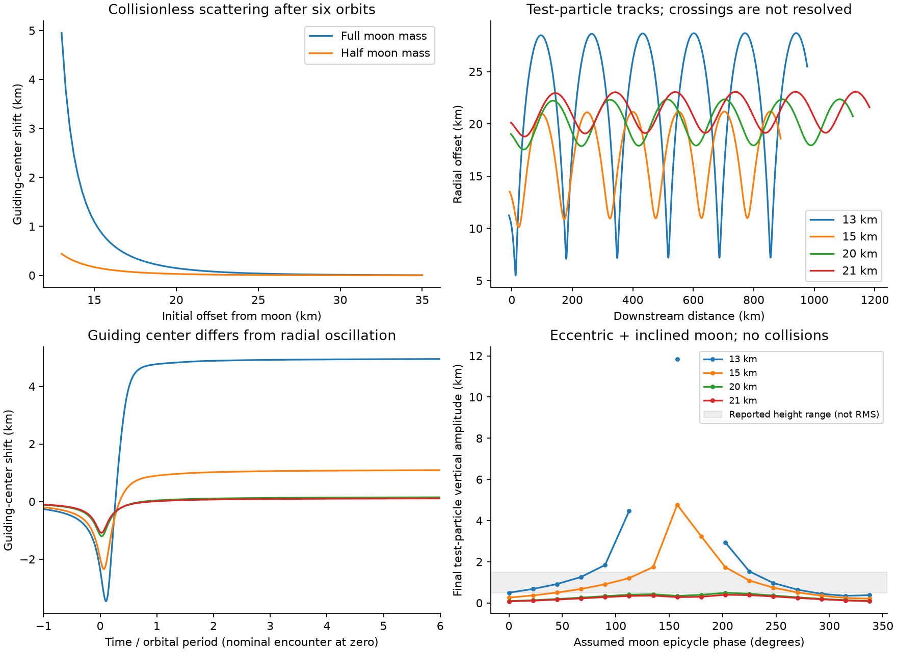

# Keeler gap: Daphnis encounters and physical-grain controls

This repository contains a reproducible numerical study of the three questions in the [problem](https://docs.google.com/document/d/1-J-R5lnwra715mJMhCLv970_IrBIYlH6mMRxi7IM-D4/mobilebasic). It tests orbital scattering, vertical energy transfer by grain collisions, and the limits of a brightness interpretation.

**This is not a validated reproduction of the Cassini images.** The orbital calculation and grain calculation are separate controls. No output here establishes the real edge's damping time or its calibrated brightness. Read [the report](REPORT.md) before interpreting a plot.



## Run

Install [uv](https://docs.astral.sh/uv/getting-started/installation/) and a C compiler if your platform has no REBOUND wheel. Python 3.12 or later is required.

```sh
uv sync --locked
uv run pytest -q
uv run python -m keeler all --extended --out runs/reproduction
uv run python -m keeler.plots runs/reproduction
uv run python -m keeler.contacts runs/reproduction
```

The complete study runs on a CPU, without a GPU or an external service. The original container had four available CPUs and a 2 GiB memory limit. The runs execute in sequence. There is no hardware speed assumption in the code. Each output records elapsed time.

For a quick orbital calculation:

```sh
uv run python -m keeler encounters --out runs/orbits
```

For one collision experiment:

```sh
uv run python -m keeler boxes --case inelastic --out runs/grains
```

Use a new output directory for each grain experiment. A repeated grain case fails instead of overwriting data. `--case` can be repeated. The additional cases need `--extended`. The `Encounter` and `Box` dataclasses expose the physical parameters for custom runs. `run(Box(...))` returns diagnostics, three particle snapshots, and metadata.

Estimate the physical particle count before choosing a large domain:

```sh
uv run python -m keeler budget --width-km 10 --length-km 1000 --tau .5 --radius-m 1
```

This estimates the cost of a resolved domain. The current code does **not** implement that complete gap-edge domain.

## Watch the horizontal-wave refinement

The new GIF series compares 250, 1,000, 4,000, 16,000, and 64,000 orbit markers under the same gravity and initial geometry. Read the [sampling results](REPORT.md#update-particle-count-refinement-with-gifs), or [play the finest GIF](results/waves/wave_64000.gif). These are collisionless markers; the imposed initial gap and omitted collisions remain model assumptions.

```sh
uv run python -m keeler.waves --out runs/wave-study
```

The command writes each GIF as its stage finishes, with profiles, numerical checks, and a final comparison to the largest count. Use a new output directory. `--counts 250 1000` selects a shorter run. Raw marker arrays are saved under the output directory, outside git.

## Files and outputs

- [REPORT.md](REPORT.md): findings, equations, observation comparison, and limitations.
- [docs/model.md](docs/model.md): numerical assumptions and units.
- [docs/sources.md](docs/sources.md): research and image provenance.
- `keeler/encounter.py`: restricted, three-dimensional Hill encounters.
- `keeler/grains.py`: physical hard spheres in a homogeneous shearing box, using REBOUND.
- `keeler/optics.py`: an illustrative single-scattering slab response and shadow geometry.
- `results/`: numerical summaries, box time series, configuration records, and figures.

All positions and speeds in the grain model use meters and seconds. The encounter archive names its dimensionless state `state_hill`; lengths use the nominal Daphnis Hill radius and time uses `1/OMEGA`. The archive stores guiding-center and epicycle lengths in meters as separate fields.

Raw `.npz` arrays are generated locally and excluded from git. They include the orbital tracks and particle snapshots. Their hashes are in the run manifest. CSV, JSON, and figures are the small review record. The manifest also records Python, package versions, source hashes, and the current git commit. Cross-platform runs should compare ensemble statistics rather than require identical particle snapshots. New CLI runs record source identity at launch. The published aggregate manifest records the analysis source at assembly. Early experiments began in an uncommitted tree; each case records its physical and numerical settings.

The grain box has no moon and no radial edge. Its initial horizontal velocity dispersion is an input, not a prediction from the orbital calculation. It tests a conversion mechanism at lower energy than a kilometer-high splash. A collisionless model cannot predict a grain-size effect. A slab image is not a Cassini photometric model.
