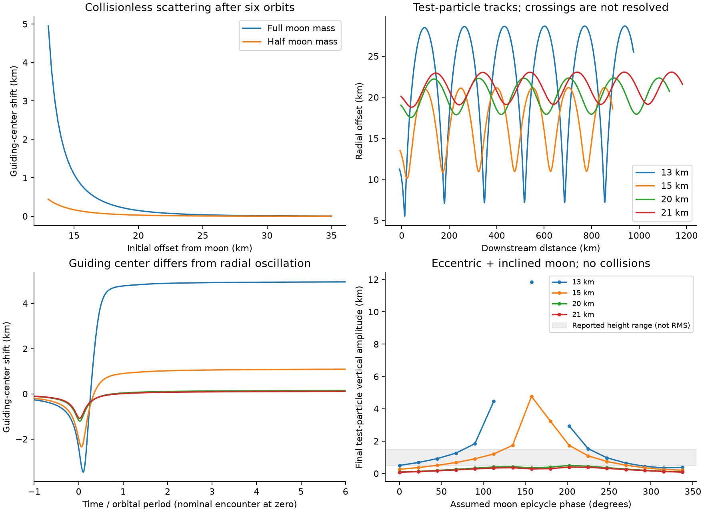
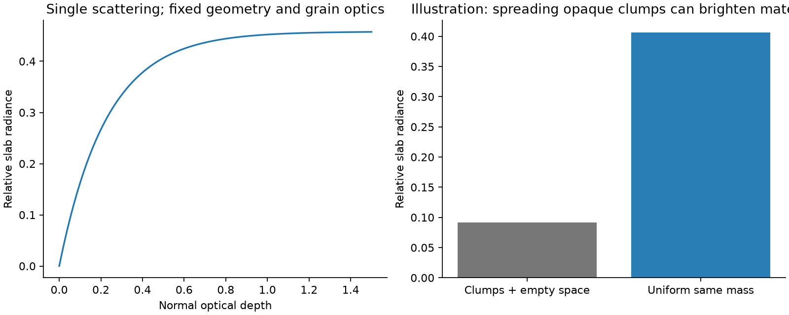

# Keeler gap study

The calculations support orbital scattering and collision-driven vertical heating. They do **not** establish a complete, physically resolved match to the three requested observations. The public code, numerical outputs, and checks make that limit testable. There is no artificial drag term or enlarged numerical grain used to obtain a desired picture.

| Question | Result from this study | What remains unverified |
| --- | --- | --- |
| Why does material pull away from Daphnis? | A restricted encounter changes guiding centers. Close encounters can produce kilometer-scale changes. Radial oscillation amplitude is measured separately. | A resolved collisional edge and its semimajor-axis distribution several orbits downstream. |
| Why are the waves brighter? | A slab calculation shows why mass density alone does not determine brightness. Breaking opaque clumps can expose more scattering area. | The actual particle arrangement, phase function, mutual shadows, and camera geometry of both images. |
| Why does material rise and then settle? | Three-dimensional hard-sphere controls transfer horizontal energy into vertical motion. Inelastic runs can then lose vertical energy; the collisionless control cannot. | The observed 0.5–1.5 km structures, their downstream location, and their damping rate in a self-consistent edge calculation. |

## Orbital scattering and apparent retreat

The nominal moon Hill radius is 4.861 km and the local orbital period is 14.292 hours. The circular-moon calculation starts upstream and follows particles for six orbital periods after nominal conjunction. The positive offsets below refer to the outer edge. The circular inner-edge result has opposite sign and equal magnitude, as checked by a test.

| Initial offset (km) | Guiding-center shift after six orbits (km) | Radial epicycle amplitude (km) |
| --- | --- | --- |
| 13 | 4.950 | 10.738 |
| 14 | 2.040 | 6.816 |
| 15 | 1.091 | 5.094 |
| 20 | 0.148 | 2.206 |
| 21 | 0.109 | 1.961 |
| 25 | 0.037 | 1.317 |

These are **guiding-center changes**, not radial excursions. The calculation uses the Hill approximation to semimajor axis. At 20 km offset the permanent change is about 0.15 km, while the radial epicycle amplitude is about 2.21 km. It would be incorrect to call that entire 2.21 km a semimajor-axis increase.

For a circular, coplanar moon, the Jacobi invariant connects the scattering to the epicycle energy. Far upstream and downstream, it gives `3 X²/4 - A² = constant` in Hill units. An encounter that excites a radial epicycle therefore also moves an outer particle's guiding center outward. In the weak limit, `delta X` is approximately `2 A² / (3 b)`. The inner particle moves inward. No grain-size parameter occurs in this massless-particle calculation.

A visible inner boundary of the outer ring is closer to `X - A` than to `X`. If collisions reduce `A`, that visible boundary can retreat by kilometers even when the ensemble's mean `X` changes little. Collisions also redistribute angular momentum among particles. They cannot create net angular momentum for an isolated pair. A full explanation of the stated *semimajor-axis* retreat therefore needs tracked particle cohorts and angular-momentum transport, not just a moving bright edge. This study does not substitute the latter for the former.

The result is strongly sensitive to encounter distance. The 13 km case produces about 4.95 km of guiding-center shift; the 21 km case produces about 0.11 km. A nominal 42 km gap does not justify selecting the close case as a fit. Published edge distances depend on epoch and geometry; see [sources](docs/sources.md).

The 16-phase eccentric/inclined sweep tests one family of moon geometries. At 20 km, direct gravitational forcing gives final vertical oscillator amplitudes of about 0.09–0.49 km. At 15 km, the range is about 0.21–4.77 km. Two of the sixteen 13 km trajectories hit the adopted moon surface and are explicitly marked as impacts. Large test-particle excursions near a close encounter are not evidence for a populated, stable ring wall. The radial and vertical moon phases are tied in this sweep; they are not an ephemeris fit.

The stationary streamlines also develop folds. At a fold the collisionless density becomes singular. This identifies where a dense ring requires particle collisions and collective dynamics. The code preserves this failure instead of imposing a damping prescription. The reported crowding factor is not a physical density prediction past crossing.

## Brightness

The first supplied image is a lit-side view at phase angle 36°. The second is also a lit-side view, at phase angle 121°. Their phase functions and viewing directions differ. The first supplied file was enlarged and sharpened. Neither file is a calibrated radiance product. See the [image provenance](docs/sources.md).

In the single-scattering slab illustration, a uniform distribution with mean optical depth 0.5 is about 4.44 times as bright as a distribution with the same mass in opaque clumps that cover 20% of the area. This is a chosen limiting example at fixed grain optics and geometry, not a predicted Cassini contrast. It demonstrates why higher brightness does not prove higher mass density.

Wake compression, disruption of self-gravity wakes, changed exposed surface area, vertical relief, and shadowing can all change the optical signal. [Tiscareno et al. (2008), section 6](https://mmhedman.github.io/papers_published/MST_proppop_aj_2008.pdf) discusses the specific possibility that disruption of opaque wakes makes material brighter even when mass density falls. The present hot, homogeneous boxes do not model that disruption at the gap edge. Fragmentation and dust production are absent, so the runs cannot establish a fine-dust explanation either.

At fixed surface density and material density, optical depth scales as `1/R` for equal-size spheres. Small grains provide more geometric area per unit mass. A size study that holds surface density, optical depth, and grain density all fixed would violate that relation. The implemented radius sweep holds the two densities fixed and reports the resulting optical depths.

## Vertical heating and damping

The base experiment contains actual 2 m radius grains, with surface density 300 kg/m² and material density 450 kg/m³. The box is 128 m wide in each horizontal direction. The imposed radial velocity dispersion is 0.02 m/s. It represents an already excited patch; it is not obtained by feeding the encounter solution into a collision model.

The inelastic control rises from about 5 m RMS height to about 85.8 m at 0.275 orbits, then reaches about 41.1 m after three orbits. The no-collision control stays near 5 m. Its vertical oscillator energy is constant to numerical precision. The elastic control continues to heat through work from the shear. These differences show conversion and dissipation without an imposed settling time.

An oblique collision changes the direction of relative velocity. It can turn horizontal epicycle energy into vertical motion while conserving pair momentum. For a normal restitution coefficient `e`, it loses `(1-e²) times the normal relative kinetic energy`. After crossing streams have heated the vertical motion, later inelastic impacts can remove that energy. Continued shear and self-gravity can also supply energy. There is no universal exponential damping rate that follows from `e` alone.

An energy check is useful before a height fit. A 0.5–1.5 km vertical oscillator amplitude needs about 0.061–0.183 m/s of vertical speed at this orbit. The 20 km encounter supplies a radial epicycle speed scale near 0.27 m/s. Converting roughly 5–46% of its radial epicycle energy could supply those vertical amplitudes. This establishes an available energy scale; it does not predict the collision geometry or the observed height.

The physical collision frequency depends on number density, cross section, relative speed, and vertical thickness. A rough dilute estimate scales with `tau * n`; this is a scaling argument, not a damping fit. At fixed surface density, changing radius changes both optical depth and the particle number. Mutual gravity can change clumping and contact speeds. The radius, gravity, box-size, time-step, and seed controls are therefore part of the study. The initial radial Toomre parameter of this hot box is about 36. It is not an equilibrium, cold self-gravity-wake model. The critical self-gravity wavelength for its surface density is about 53 m, so the small box also samples few such wavelengths.

<!-- grain-results -->

The base heights are below the reported 0.5–1.5 km structures. The initial horizontal energy was deliberately much lower than the strongest moon encounters. Scaling this box's height by an arbitrary factor would change collision rates and gravitational coupling, so it would not validate a kilometer-high wall. In addition, RMS height, maximum particle altitude, and an optically visible shadow-casting wall are different measurements.

[Recent full N-body work](https://arxiv.org/abs/2504.10989) favors collision-driven walls, with eccentric forcing controlling their strength and location. That is evidence from the cited work. It is not a result independently established by these local boxes.

At a chosen solar elevation of 1°, a 1 km height casts a 57.3 km shadow on a flat plane. This follows from `length = height / tan(elevation)`. The actual image needs its solar elevation, azimuth, camera projection, obscuration, and optical threshold. The supplied caption alone does not provide that full geometry.

## Numerical checks and limits

The gravity-accuracy controls cover only the first half orbit, through the initial heating peak. The baseline gravity run covers three orbits, but its late damping curve has not passed a full-duration gravity-convergence study.

The tests cover free shear, the Jacobi invariant and its scattering-energy relation, mirror symmetry, planar symmetry, free vertical energy, binary collision momentum and energy, oblique vertical excitation, physical mass/radius scaling, initial nonoverlap, gravity-tree agreement with direct gravity, sheared contact checks, and the vertical boundary. The run fails on particle loss, nonfinite output, a sampled excessive crossing speed, or a vertical boundary approach.

Tightening encounter tolerance from `2e-10` to `2e-12` changes the 20 km shift by about `0.0000002 m`. This does not bound model error. Moving the upstream start from dimensionless time -120 to -480 changes the six-orbit shift from 147.7 m to 143.1 m. With that farther start, extending the final time from six to twenty-four orbits raises it to 158.4 m. The moon still supplies a weak torque at finite separation. The tables report finite-time quantities rather than an invented asymptotic precision.

The Hill model omits Saturn's oblateness, other moons, ring gravity, and grain interactions. Prescribed eccentric/inclined motion omits precession and the moon's response to the ring. Very distant Hill starts test the mathematical model, not its global accuracy. The hard-sphere model omits friction, spin, adhesion, fragmentation, and sustained contacts. The optical illustration omits multiple scattering, mutual shadows, and image calibration. These limits prevent a trusted quantitative observational fit.

The vertical boundary required special care. REBOUND's shear boundary wraps in `z`, even with zero vertical ghost boxes. The initial cubic-box results were discarded. The delivered runs use a much taller domain and a boundary guard. A regression test fails with the original cubic setup.

## Compute and reproduction

The container has a 2 GiB memory limit and four available CPUs. No host or GPU compute was used. Independent grain cases were divided among CPU processes for the recorded study; the public CLI runs them in sequence. The recorded small-box counts and elapsed times are in [box_summary.csv](results/box_summary.csv). The exact settings are in each case's JSON file.

For scale, a single 10 km by 1,000 km strip at optical depth 0.5 and 1 m grain radius needs about **1.59 billion grains**. REBOUND's 128-byte particle structure alone would require about **190 GiB**, before trees, collision lists, neighboring mass, or output. This is an estimate for that explicit domain, not a proof that every possible numerical method needs that much memory. A reduced kinetic or scaled method would need its own validation before it could answer the physical-size questions.

A full follow-on calculation must couple the moon encounter to a resolved collisional edge, supply unperturbed upstream material, check radial and azimuthal domain convergence, follow angular-momentum and energy budgets, and compare synthetic images at the actual observing geometry. A sufficiently large machine is not the only missing item: this repository's homogeneous box is not that complete domain solver. No command here is represented as a hidden route to a full Cassini fit.

Use the commands in [README.md](README.md) to reproduce the controls and regenerate the raw trajectories and grain snapshots. The results identify mechanisms and reject misleading shortcuts. The complete three-feature observational validation remains open.
